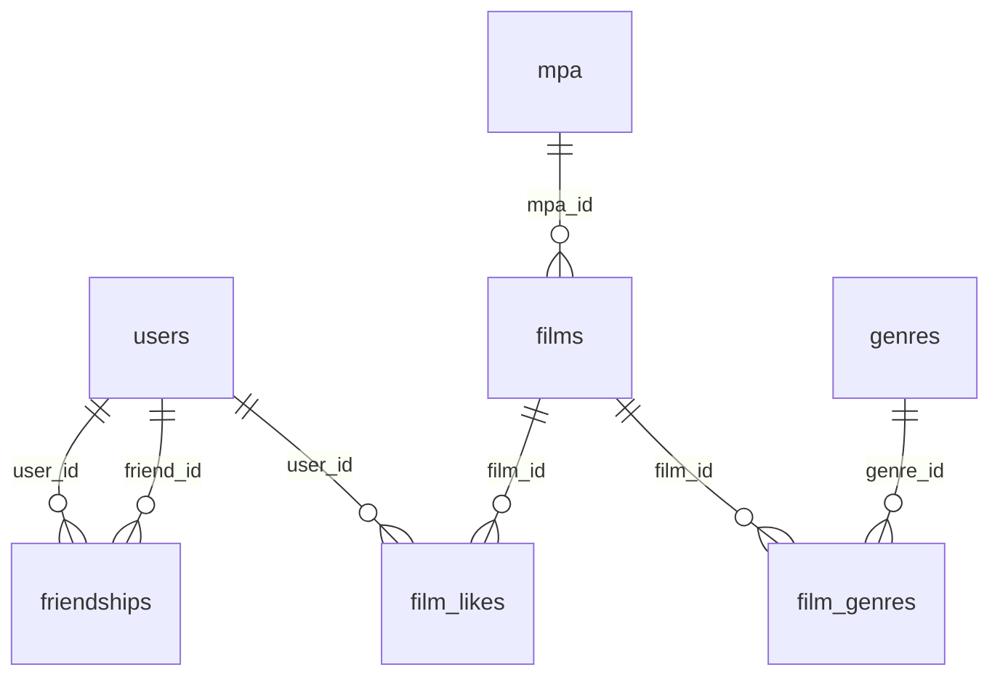

# Filmorate

Spring Boot 3.2, Java 21, JDBC и встроенная база H2.

Запуск: `mvn spring-boot:run`. Приложение доступно на `http://localhost:8080`.
Рабочие данные сохраняются в `./db/filmorate.mv.db`. Подключение к H2:
`jdbc:h2:file:./db/filmorate`, пользователь `sa`, пароль `password`.
Для подключения из внешнего клиента сначала остановите приложение.

`schema.sql` создаёт отсутствующие таблицы, `data.sql` заполняет справочники.
Повторный запуск сохраняет пользователей, фильмы, лайки и дружбу.

Фильмы принимают рейтинг и жанры по идентификаторам:

```json
{
  "name": "Фильм",
  "description": "Описание",
  "releaseDate": "2000-01-01",
  "duration": 120,
  "mpa": {"id": 3},
  "genres": [{"id": 1}, {"id": 2}]
}
```

Рейтинг обязателен. В ответах возвращаются также названия справочников;
жанры отсортированы по id, повторяющиеся id объединяются. При обновлении
список жанров заменяется; пустой или отсутствующий список очищает жанры.

- `GET /genres`, `GET /genres/{id}` — жанры.
- `GET /mpa`, `GET /mpa/{id}` — рейтинги MPAA: G, PG, PG-13, R, NC-17.
- `POST /users`, `PUT /users`, `GET /users`, `GET /users/{id}` — пользователи.
- `POST /films`, `PUT /films`, `GET /films`, `GET /films/{id}` — фильмы.
- `PUT /users/{id}/friends/{friendId}` — заявка в друзья; встречный запрос подтверждает дружбу.
- `DELETE /users/{id}/friends/{friendId}` — удаление исходящей связи.
- `GET /users/{id}/friends`, `GET /users/{id}/friends/common/{otherId}` — друзья и общие друзья.
- `PUT /films/{id}/like/{userId}`, `DELETE /films/{id}/like/{userId}` — лайки.
- `GET /films/popular?count=10` — популярные фильмы по числу лайков, при равенстве по id.

Дружба направленная: заявка A → B добавляет B в список A. Список B меняется
только после его собственного запроса. Повторные заявки и лайки не создают дублей.
Неизвестные идентификаторы возвращают 404, ошибки валидации — 400.

Схема данных:



Проверка: `mvn test`. Тесты используют H2 в памяти; отдельный тест проверяет
сохранение данных в файловой базе после повторного открытия во временном каталоге.
DAO-тесты с `@JdbcTest` покрывают все публичные методы хранилищ, ограничения
схемы и откат транзакций. API-тесты проверяют JSON, статусы и бизнес-сценарии.

Предоставленный `ci-sprint.json` пуст. Для запуска внешних Postman-тестов нужна
заполненная коллекция `sprint.json`: `newman run sprint.json` при запущенном приложении.
